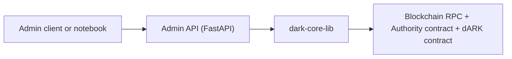
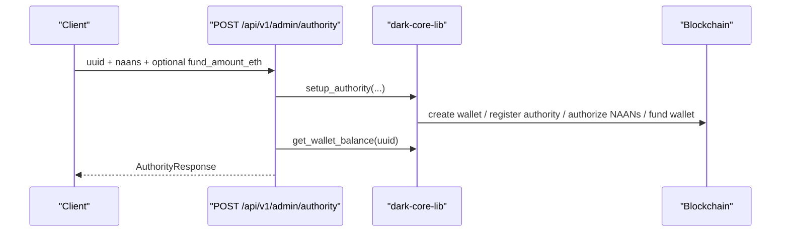
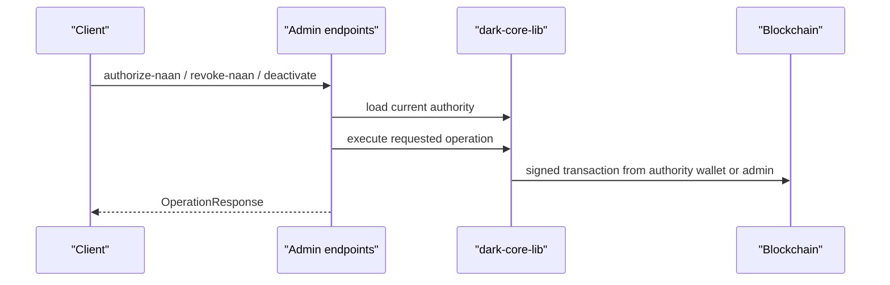
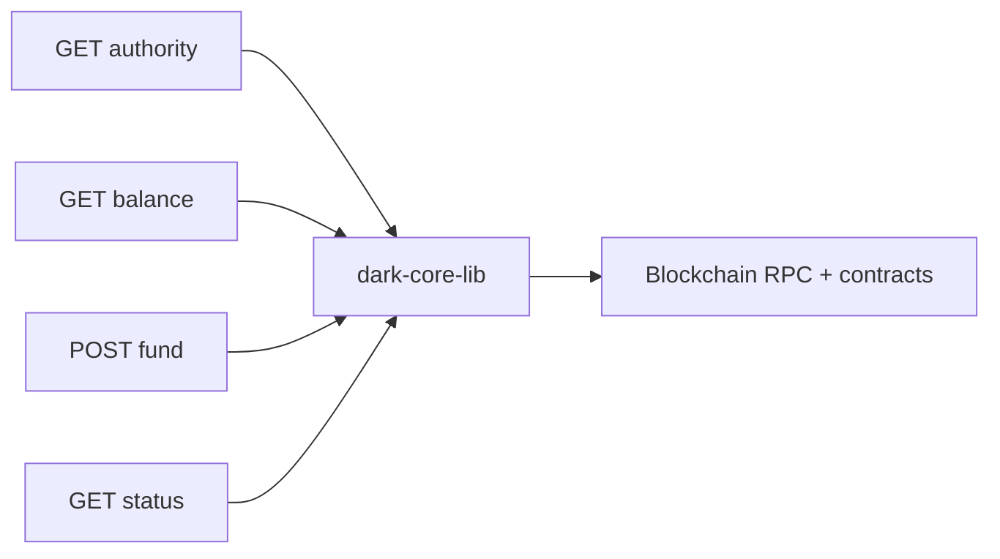

# dARK Core Admin API

New platform developer: follow [developer onboarding](https://github.com/LA-Referencia-IOI/dark-deployer/blob/main/docs/developer-onboarding.md)
for the complete local stack, signed requests and component iteration.

Administrative REST API for authority onboarding and authority management in the dARK network, powered by `dark-core-lib`.

## Overview

`dark-core-admin-api` is the service used to operate the authority layer of the dARK stack from an admin node. Unlike the minter, it does not keep a local lifecycle database or background worker. It is a thin HTTP layer over `dark-core-lib` for privileged operations such as:

- registering new authorities
- authorizing and revoking NAANs
- deactivating authorities
- funding authority wallets
- checking balances and admin status
- reading global ARK statistics (total count and recent ARKs)

This service is intended for controlled administrative environments, not for public exposure.

## Documentation Map

Use the docs in this order:

- [README.md](README.md)
  - operational overview, endpoints, deployment, config
- [admin-architecture.md](docs/architecture.md)
  - technical implementation details, module map, request flows
- [notebooks/README.md](notebooks/README.md)
  - notebook usage and environment variables

## Runtime Architecture

If you want the implementation-oriented view behind this diagram, continue with [admin-architecture.md](docs/architecture.md).



## Main Responsibilities

- Admin API
  - exposes administrative HTTP endpoints
  - validates request payloads
  - applies the mTLS gate when enabled
  - translates `dark-core-lib` exceptions to HTTP responses
- `dark-core-lib`
  - owns the blockchain client
  - signs transactions with the admin key
  - implements authority management operations
- Blockchain
  - stores the final source of truth for authorities, NAAN authorization, and authority activity

## Main Flows

### 1. Register Authority

Registering an authority is the highest-level operation in the service.



What this does conceptually:

- creates the authority wallet material
- registers the authority on-chain
- authorizes the requested NAANs
- funds the wallet using the admin account (with a configurable amount)

### 2. Manage Authority Permissions

These operations mutate the on-chain authority state directly.



Current mutation endpoints:

- `POST /api/v1/admin/authority/{uuid}/authorize-naan`
- `POST /api/v1/admin/authority/{uuid}/revoke-naan`
- `POST /api/v1/admin/authority/{uuid}/deactivate`

### 3. Wallet and Status Operations

Read and funding flows are simpler, but still depend on the configured admin signer and blockchain client.



## API Surface

| Method | Endpoint | Purpose |
|--------|----------|---------|
| `GET` | `/health` | Health and blockchain/admin connectivity |
| `GET` | `/health/live` | Cheap process liveness check; no RPC or storage calls |
| `GET` | `/api/v1/admin/status` | Admin address, balance, block, chain id |
| `POST` | `/api/v1/admin/authority` | Register new authority |
| `GET` | `/api/v1/admin/authority/{uuid}` | Get authority info |
| `POST` | `/api/v1/admin/authority/{uuid}/authorize-naan` | Authorize NAAN |
| `POST` | `/api/v1/admin/authority/{uuid}/revoke-naan` | Revoke NAAN |
| `POST` | `/api/v1/admin/authority/{uuid}/deactivate` | Deactivate authority |
| `GET` | `/api/v1/admin/authority/{uuid}/balance` | Get authority wallet balance |
| `POST` | `/api/v1/admin/authority/{uuid}/fund` | Fund authority wallet |
| `GET` | `/api/v1/arks/count` | Total ARKs registered on the blockchain |
| `GET` | `/api/v1/arks/recent` | Most recent ARKs with their metadata CIDs |

### Global ARK read endpoints

Implemented in `app/api/arks.py`, these are dashboard-facing reads over `dark-core-lib` served through a short-lived process-local cache (30 s TTL):

- `GET /api/v1/arks/count` returns `{"count": <int>}` — the total number of ARKs registered on-chain.
- `GET /api/v1/arks/recent?limit=10` returns `{"limit": <int>, "arks": [{"pid", "naan", "name", "owner", "url", "cid"}]}` — the most recent ARKs, newest first. `limit` defaults to `10` and is bounded to `1`–`100`. `cid` is the Level-1 metadata CID.

## Security Model

### Current Behavior

- every admin and ARK read route is protected with `require_mtls`
- when `MTLS_ENABLED=false` (the default), the middleware allows requests through
- when `MTLS_ENABLED=true`, the request must present a valid client certificate path as understood by the deployment

The standard container starts Uvicorn without TLS arguments, and the deployer
does not set `MTLS_ENABLED` in the ordinary Admin environment. Enabling the gate
therefore requires a separately configured TLS termination boundary. The gate can
accept `X-SSL-Client-*` headers; only a trusted proxy that strips client-supplied
values and supplies verified values should be allowed to reach it. The Dashboard
client does not configure a client certificate on its Admin API calls.

### Important Operational Note

This API performs privileged admin operations and should be treated as highly sensitive. In production it should:

- run with mTLS enabled
- be reachable only from trusted operator networks
- use a protected admin private key source
- avoid direct public internet exposure

## Quick Start

### Local development (including a checkout inside `dark-deployer`)

From this component's root, use a separate Python 3.14 environment:

```bash
python3.14 -m venv .venv
.venv/bin/python -m pip install -e '.[dev]'
.venv/bin/python -m pip install -e ../dark-core-lib
source .venv/bin/activate
```

The sibling `dark-core-lib` checkout is required. Do not install several APIs
into the controller environment: they each contain a package named `app`.
Run the commands below from **this component directory**. Set the documented
runtime configuration first; installing Python packages does not start the
chain, Store or databases. The [platform onboarding guide](https://github.com/LA-Referencia-IOI/dark-deployer/blob/main/docs/developer-onboarding.md)
provides the complete local stack, internal Docker endpoints and a working-tree
Resolver example. Keep component tests in this isolated environment.

### Run Manually

```bash
uvicorn app.main:app --host 0.0.0.0 --port 8000 --reload
```

## Tests

From this component directory, after installing the isolated dev environment:

```bash
.venv/bin/python -m pytest
```

The HTTP tests mock the blockchain client. A passing suite does not establish
that contracts are deployed or that the configured admin wallet is authorized;
use the onboarding authority/deposit flow for that integration check.

## Deployment

dark-core-admin-api is deployed by the [dark-deployer](https://github.com/LA-Referencia-IOI/dark-deployer) from an operator inventory (format `dark-operator-inventory` v3; see the [inventory reference](https://github.com/LA-Referencia-IOI/dark-deployer/blob/main/examples/operator-inventory/README.md)). The deployer resolves the inventory, renders one Docker Compose project per machine and applies it through guided operations (`./deploy.sh operation plan`, `apply`, `resume`; see the [deployer documentation](https://github.com/LA-Referencia-IOI/dark-deployer/blob/main/docs/deployer.md)). The image is built from this repository at the branch declared in the inventory (`overrides.components`; default `main`). Runtime environment variables are generated from the inventory, not edited by hand. There is no standalone docker-compose file in this component.

## Configuration

The service reads environment configuration from `.env` and `.env.integration`.

### API Runtime

| Variable | Description | Default |
|----------|-------------|---------|
| `ADMIN_API_HOST` | API bind host | `0.0.0.0` |
| `ADMIN_API_PORT` | API bind port | `8000` |
| `DEFAULT_FUND_AMOUNT_ETH` | Default funding amount for new authorities | `0.01` |

### Blockchain

| Variable | Description |
|----------|-------------|
| `DARK_RPC_URL` | RPC endpoint |
| `DARK_CHAIN_ID` | Chain id |
| `DARK_AUTHORITY_ADDRESS` | Authority contract address |
| `DARK_CONTRACT_ADDRESS` | dARK contract address |
| `DARK_ADMIN_PRIVATE_KEY` | Admin signer private key |

These values are required for a functional deployment.

### TLS and mTLS

| Variable | Description | Default |
|----------|-------------|---------|
| `MTLS_ENABLED` | Enable mTLS gate | `false` |
| `TLS_CERT_FILE` | Server certificate path | - |
| `TLS_KEY_FILE` | Server private key path | - |
| `TLS_CA_FILE` | CA certificate path | - |

## Useful URLs

Once the service is running:

- Swagger UI: `http://localhost:8000/docs`
- ReDoc: `http://localhost:8000/redoc`
- Liveness: `http://localhost:8000/health/live`
- Health: `http://localhost:8000/health`
- Admin status: `http://localhost:8000/api/v1/admin/status`

## Notebook

The service includes one HTTP-level integration notebook:

- [notebooks/admin_api_test.ipynb](notebooks/admin_api_test.ipynb)

See [notebooks/README.md](notebooks/README.md) for usage notes.

## Troubleshooting

### API fails on startup

Check:

1. blockchain RPC is reachable
2. contract addresses are configured
3. `DARK_ADMIN_PRIVATE_KEY` is set
4. if mTLS is enabled, all TLS file paths exist

### Health is unhealthy

Check:

1. `DARKCoreClient` initialized correctly
2. blockchain node is reachable
3. the admin account still has spendable balance

### Admin operation returns blockchain or authority error

Check:

1. the authority exists on-chain
2. the NAAN is in the expected current state
3. the admin account has permission to perform the operation
4. the admin account has enough balance for gas and funding

## Related Docs

- [admin-architecture.md](docs/architecture.md)
- [notebooks/README.md](notebooks/README.md)


## Minter client signing keys

Authority creation accepts optional `client_public_key` (base64 of a raw 32-byte
Ed25519 public key). When supplied, wallet registration and key assignment are
atomic in `register_authority_with_client_key`. Without it, existing unsigned
installations can still create authorities. Signed Minter mode rejects missing
keys. Replace a key through authenticated
`PUT /api/v1/admin/authority/{uuid}/client-key` with the same field. This preserves
UUID, wallet, NAANs and PID ownership. The private key never reaches Admin.
These operations require the updated Authority contract and ABI.

GET `/api/v1/admin/authority/{uuid}/client-key` returns `uuid`,
`client_public_key` (raw base64 or null), `key_id` (SHA-256 hex or null) and
`active`, read from blockchain. Registry failures are returned as errors,
not as null keys. Public-key registration and replacement also accept OpenSSH
`ssh-ed25519` public keys with optional comments and normalize them to raw bytes.

## Ownership transfer and retirement

Each authority operates in one logical Minter; different authorities can use different nodes. Admin transfers only on blockchain, without reading or changing Minter PostgreSQL. Local queues and pending replication do not restrict transfer. Admin inventories current chain owners and blocks retirement while on-chain PIDs remain; stop the authority’s activity and settle in-flight transactions before retirement. The previous request-ID resume API, database retirement gates and transfer coordination dependency were removed.

Minter trusts local identity for normal queued publication and verifies owner/active status/NAAN permissions after a failure. Ownership loss marks the original job obsolete without signing it as the successor. Local-only tombstone/retry verify ownership first; reservations verify active status. A successor request can import the chain PID, archiving superseded local payload under its original authority. Migration `0004_remove_admin_coordination` preserves historical audit rows and creates local `superseded_ark_jobs`. `MINTER_ALLOWED_AUTHORITY_IDS` supplies disjoint assignments for independent Minters (empty means single-Minter unrestricted deployment). See deployer `docs/pid-ownership-transfer-design.md` for API, recovery and operational limitations.
